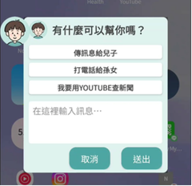
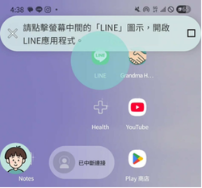
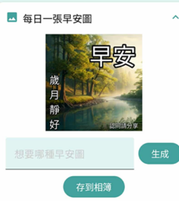

# GrandmaHelper 📱👵

**An intelligent smartphone assistant app designed for seniors**

*Helping seniors to use smartphones with confidence, skill, and joy.*

---

## About GrandmaHelper

GrandmaHelper is an Android application that helps seniors navigate smartphones more easily, particularly the LINE messaging app. The app acts as a bridge, making modern technologies accessible for seniors by providing AI-powered guidance that helps them use their phones with confidence, skill, and joy.

<p align="center">
  
  
  
</p>

## Awards

- **1st Place – Google Track, Mei-Chu Hackathon 2025**  
- **1st Place – Mei-Chu Grand Prize 2025**  
- **Popularity Award – Mei-Chu Hackathon 2025**

## Core App Features

### Floating Bubble Assistant
- **Always Available**: Screen overlay bubble that provides guidance at any time
- **Context-Aware**: Understands current screen content and user goals
- **Voice Integration**: Text-to-speech announcements for better accessibility
- **Easy Toggle**: Simple on/off controls in the main app

### AI-Powered Step Guidance
- **Smart Instructions**: AI analyzes screen content and provides step-by-step guidance
- **Goal-Oriented**: Remembers user objectives and guides toward completion
- **Tap Indicator**: Visual indicators show exactly where to tap on screen
- **Chinese Language**: Optimized for Traditional Chinese LINE interface

### Greeting Image Service
- **Personalized Greetings**: Auto-generates custom Chinese morning greeting images
- **Festival Awareness**: Detects holidays and creates themed images
- **One-Tap Sharing**: Generate and save images directly to gallery for easy sharing
- **Beautiful Design**: AI-generated backgrounds with elegant Chinese typography

### Accessibility Integration
- **Screen Reader Support**: Deep integration with Android accessibility services
- **Large Touch Targets**: Optimized UI for users with motor difficulties
- **High Contrast**: Clear visual indicators and readable text
- **Tutorial System**: Built-in guided tutorials for first-time users

## Supporting Backend Services

The app is powered by three cloud-based services that handle AI processing and monitoring:

### 1. LINE Support API 
- **Purpose**: Main AI brain that processes user requests and provides guidance

### 2. Greeting Image Service 
- **Purpose**: Creates personalized morning greeting images with Chinese text

### 3. Status Monitor 
- **Purpose**: Monitors the health and performance of all services

## Technology Stack

### Android App
- **Language**: Kotlin
- **UI Framework**: Jetpack Compose + Material Design 3
- **Architecture**: MVVM pattern with StateFlow
- **Key Components**: 
  - Foreground Service for bubble overlay
  - Accessibility Service for screen monitoring
  - Text-to-Speech for voice guidance
  - Camera/Gallery integration for image sharing

### Backend Services
- **Framework**: Python Flask
- **AI Services**: Google Vertex AI (Gemini 2.5 Flash, Imagen 3.0)
- **Database**: PostgreSQL with pgVector for semantic search
- **Cloud Platform**: Google Cloud Run
- **Infrastructure**: Docker containers with automated deployment

## Project Structure

```
GrandmaHelper/
├── app/                          # Android Application
│   ├── src/main/java/com/example/bubbleassistant/
│   │   ├── MainActivity.kt       # Main screen - Settings & Morning Images
│   │   ├── BubbleService.kt      # Floating bubble overlay service
│   │   ├── ScreenMonitor.kt      # Screen monitoring (Accessibility Service)
│   │   ├── ChatDialogActivity.kt # Chat interface
│   │   ├── TutorialActivity.kt   # Tutorial screens
│   │   ├── GreetingImage.kt      # Morning image generation UI
│   │   └── TextToSpeechManager.kt # Voice guidance system
│   └── build.gradle.kts          # Android project configuration
├── services/                     # Backend Microservices
│   ├── line-support-api/         # Main AI Assistant API
│   │   ├── main.py              # Flask application
│   │   ├── requirements.txt     # Python dependencies
│   │   └── Dockerfile           # Container configuration
│   ├── image-generation-api/     # Image Generation Service
│   │   ├── src/core/app.py      # Main application
│   │   ├── src/utils/text_overlay.py # Chinese text overlay
│   │   ├── config/              # Configuration files
│   │   └── tests/               # Test files
│   └── status-monitor/           # System Monitoring Service
│       ├── main.py              # Monitoring application
│       ├── templates/status.html # Status page template
│       └── uptime_history.json  # Uptime history data
├── realtimeMonitor.py           # Real-time monitoring tool
└── README.md                    # This file
```

## Getting Started

### Prerequisites
- **Android Development**: Android Studio, SDK 24+
- **Device**: Android device for testing
- **Backend** (optional): The app works with deployed cloud services
